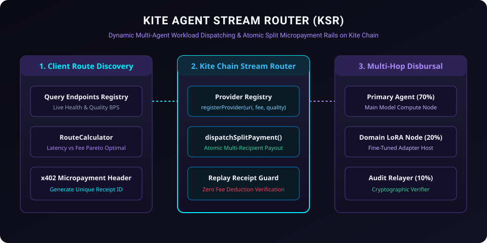

# Kite Agent Stream Router (KSR)

<p align="center">
  
</p>

[](LICENSE)
[](https://gokite.ai)
[](#routing-mechanisms)
[](https://www.typescriptlang.org)

**Kite Agent Stream Router (KSR)** is a high-throughput on-chain payment routing and multi-agent workload dispatcher protocol architected specifically for **Kite Blockchain** (EIP-155: Chain IDs `2366` / `2368`).

It enables autonomous AI agents to dynamically discover available service endpoints, calculate optimal routing paths based on latency, model tier, and compute cost, and execute atomic split-micropayments through Kite Chain's native **x402 payment rails**.

---

## ⚡ Core Capabilities

- **Dynamic Route Optimization**: Evaluates agent provider latency scores, capacity quotas, and fee schedules to route queries to the lowest-cost, highest-performance provider.
- **Atomic Multi-Hop Fee Splitting**: Automatically disburses revenue shares across the base model provider, fine-tuned adapter host, and verification auditor in a single on-chain transaction.
- **x402 Receipt Validation & Nonce Guard**: Enforces single-use cryptographic receipts (`receiptId`), replay protection, and zero fee deductions.
- **Provider Performance Slashing**: Allows clients to report unresponsive or degraded endpoints; automated stake slashing triggers upon cryptographically verified timeout thresholds.

---

## 📐 Architecture & Data Flow

```
                      +-----------------------------+
                      |    Client AI Agent (Buyer)  |
                      +--------------+--------------+
                                     |
               (1) Query Best Route & Deposit Payment
                                     v
                  +------------------------------------+
                  |    KiteAgentStreamRouter.sol       | <--- Kite Chain (EIP-155)
                  +-----------------+------------------+
                                    |
          +-------------------------+-------------------------+
          | (2) 80% Primary Compute | (3) 15% Adapter Royalty | (4) 5% Verification Auditor
          v                         v                         v
+-------------------+     +-------------------+     +-------------------+
| Foundation Agent  |     | Domain LoRA Agent |     |  Receipt Auditor  |
+-------------------+     +-------------------+     +-------------------+
```

---

## 🛠 Smart Contracts & TypeScript SDK

- **`contracts/KiteAgentStreamRouter.sol`**: Solidity 0.8.24 smart contract providing:
  - `registerProvider(string endpoint, uint256 feeRate, uint16 qualityBps)`
  - `routePaymentWithSplit(bytes32 routeId, address[] recipients, uint16[] bpsSplits)`
  - `slashUnderperformingProvider(address provider, bytes proof)`
- **`src/route-calculator.ts`**: High-performance Dijkstra/Weighted path evaluation algorithm calculating latency-fee pareto efficiency.
- **`src/router-client.ts`**: Kite Chain Viem/Ethers provider client with automated gas-free fee relayer dispatch.
- **`test/router.test.ts`**: Comprehensive automated test suite validating multi-hop split accounting and route selection.

---

## 🚀 Quick Start

### Installation

```bash
git clone https://github.com/specificpict/kite-agent-stream-router.git
cd kite-agent-stream-router
npm install
```

### Run Test Suite

```bash
npm test
```

---

## 📜 License

Licensed under the [Apache License, Version 2.0](LICENSE).
